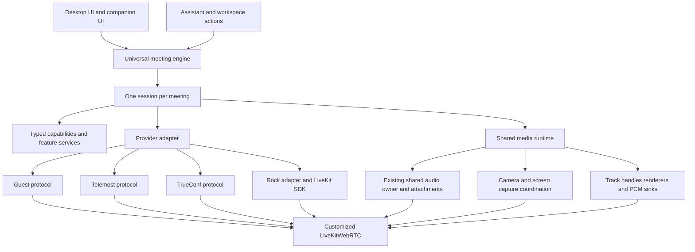

# Native Mac universal meeting engine implementation plan

Status: implementation complete in working tree (`0f2ea2651cda4473e8bc64a12aac367e9194207f`); deterministic XCTests, standalone fixture gates, local-SFU 1+5 benchmark, and unsigned Release artifact/symbol/LinkMap audits pass; live invites, physical audio route matrix, macOS 13 physical host, endurance soak, and signed/notarized distribution remain explicitly `unqualified_or_skipped` — see [qualification ledger](native-mac-universal-engine-qualification-ledger-2026-11-17.md).

Baseline: repository commit `fb491b0825dfe44b7db320e558000fc7158ec98f`, inspected on 17 November 2026. This plan supersedes the earlier proposal to remove LiveKit from the Mac artifact. It extends the existing [shared audio engine work](r4-shared-engine-plan.md); historical status sections in that document are not evidence of the current release configuration.

## Objective and retained dependencies

Give the native Mac app one application-owned meeting engine for Guest/Jazz, Telemost, TrueConf and Rock. Keep our customized `LiveKitWebRTC` framework as the common media foundation. Keep the pinned, patched LiveKit Swift SDK for Rock room transport, including its required transitive components and notices. Reuse the existing native provider protocols.

“One engine” means one app-facing implementation of session state, media intent, feature access, device ownership, capture coordination, recovery supervision and teardown. There will be a separate session for every meeting and separate provider adapters. Each service retains its required signaling, negotiation and peer topology. Rock's adapter can delegate negotiation and reconnect to LiveKit.

The delivered Mac artifact must use one approved WebRTC build and contain no Jazz, Telemost or TrueConf client SDK. LiveKit Swift, `RustLiveKitUniFFI`, `LiveKitWebRTC` and their required resources remain allowed. Provider names and license text are not evidence of an unwanted SDK. Other application dependencies, including speech and update libraries, remain outside this consolidation.

This project covers the native Mac app, including its companion entry point, simultaneous meetings, Presenter and assistant integration. It does not change the iOS app, provider servers, Rock's token API, the underlying WebRTC revision, codecs or DSP algorithms as a general modernization exercise. Any media patch needed to resolve an identified blocker gets its own source and runtime validation. Keep domain contracts portable so a later iOS port can reuse them; do not turn the Mac migration into an iOS port or a package-wide file reorganization.

## Review of the previous plan

| Finding | Required correction |
| --- | --- |
| A shared physical audio owner already exists in production. | Extend `SharedAudioEngine` and its meeting attachments; do not introduce another device owner. |
| Sharing the framework is different from sharing lifecycle and feature orchestration. | Consolidate the app-owned orchestration, not only names or a facade around four unchanged engines. |
| `DesktopMeetingModel` directly casts engines for chat, reactions, transcripts, approved actions, screen sharing and cancellation. | Migrate these feature paths as part of the core change. Removing only the construction switch leaves the architecture split. |
| Guest, external sessions and LiveKit already own recovery machinery. | Establish exactly one retry executor per connection. A common supervisor must never start another reconnect alongside the adapter or SDK. |
| Rock's SDK can adopt the audio factory, but also has a rendering factory and SDK-owned tracks/capture. | Define physical ownership separately from factory and peer counts. Keep the SDK bridge within the media/provider boundary. |
| An existing Rock integration test expects an input-route limitation after an earlier Guest graph has started. | Resolve and qualify arbitrary provider join order before declaring the engine universal. Preserve the safe refusal while the route is unproven. |
| Capture is currently owned partly by the shell, and Leave has a special concurrent abort path. | Transfer ownership explicitly and preserve drain barriers; a simple sequential “stop everything, then disconnect” can deadlock pending startup. |
| Several live tests prove local counters or facade behavior only. | Add independent receiving-peer evidence; skipped opt-in tests remain unqualified. |

The direction is sound, but the previous plan underestimated the Rock audio-route issue, feature coupling in the shell, and recovery/teardown concurrency. The sequence below addresses those before deleting working implementations.

## Current code and migration map

| Current owner | Current responsibility | Intended destination |
| --- | --- | --- |
| [NativeDesktopExternalEngine.swift](../NativeMacGuest/Engines/NativeDesktopExternalEngine.swift) | Common protocol, snapshots, raw media references and permissive default methods | Evolve into the common session contract; explicit capabilities and typed outcomes replace silent success for unsupported actions |
| [DesktopMeetingModel.swift](../NativeMacGuest/DesktopMeetingModel.swift) | UI state plus provider construction, feature wiring, sharing, intent, cancellation and teardown | Presentation state and user interaction; call the universal session and typed feature services |
| [SharedAudioEngine.swift](../NativeMacGuest/Engines/SharedAudioEngine.swift) and [SharedGuestMeetingAudio.swift](../NativeMacGuest/Engines/SharedGuestMeetingAudio.swift) | Physical audio owner, factory, talk role, attachments, mute gates and recovery | Retained physical audio authority inside the common runtime |
| [SharedAudioEngine+LiveKit.swift](../NativeMacGuest/Engines/SharedAudioEngine+LiveKit.swift) | Patched SDK factory/observer adoption and Rock sender bridge | Retained, isolated LiveKit integration with startup-order guarantees |
| [NativeDesktopGuestEngine.swift](../NativeMacGuest/Engines/NativeDesktopGuestEngine.swift), [GuestSession.swift](../Experiments/NativeGuest/GuestSession.swift), [GuestEngine.swift](../Experiments/NativeGuest/GuestEngine.swift) | Guest facade, session attempts, modern guest signaling, publications and features | Guest adapter; extract duplicated app policy while preserving Guest protocol sequencing |
| [NativeDesktopExternalSession.swift](../NativeMacGuest/Engines/NativeDesktopExternalSession.swift), [NativeDesktopProviderSignals.swift](../NativeMacGuest/Engines/NativeDesktopProviderSignals.swift) | Shared Telemost/TrueConf orchestration with provider branches | Separate Telemost and TrueConf adapters; common runtime owns app policy |
| [NativeDesktopRTCPeer.swift](../NativeMacGuest/Engines/NativeDesktopRTCPeer.swift) and [GuestPeer.swift](../Experiments/NativeGuest/GuestPeer.swift) | SDP/ICE, peer lifetime and native media operations | Keep protocol-sensitive ordering; consolidate proven common peer operations incrementally |
| [NativeDesktopRockEngine.swift](../NativeMacGuest/Engines/NativeDesktopRockEngine.swift), [NativeDesktopRockPolicies.swift](../NativeMacGuest/Engines/NativeDesktopRockPolicies.swift) | LiveKit Room, track publication, subscriptions, chat and frame bridges | Rock adapter plus common media/feature bridges; SDK retains wire transport |
| [DesktopShareCapture.swift](../NativeMacGuest/DesktopShareCapture.swift), [DesktopPresenterSession.swift](../NativeMacGuest/DesktopPresenterSession.swift), [NativeDesktopCameraLease.swift](../NativeMacGuest/NativeDesktopCameraLease.swift) | Screen capture, Presenter and camera lease | Session-scoped capture coordination using the existing platform implementations |
| [LocalTranscription.swift](../NativeMacGuest/Attention/LocalTranscription.swift) | PCM sinks with both native and LiveKit types | Provider-neutral audio-source contract; LiveKit sink adaptation moves behind its adapter |
| [MeetingController.swift](../NativeMacGuest/MeetingController.swift) | Companion UI with a direct GuestSession path | Same universal session, preserving companion's exclusive talk admission |
| [NativeDesktopSharedMedia.swift](../NativeMacGuest/NativeDesktopSharedMedia.swift) | Legacy media reservation and suspension used by shell paths | Audit actual reachability; migrate needed reservations before removing old ownership code |

Source currently forces shared audio on for ordinary Release builds; only Debug or explicit legacy comparison builds can select the old path. That is distinct from runtime qualification. Rock's additional rendering factory does not by itself prove a second physical audio owner.

## Target architecture

The diagram shows ownership and dependency boundaries, not one shared peer connection. A provider adapter may own multiple WebRTC peers or one SDK Room. It obtains media resources through the common runtime and cannot create an independent physical audio owner.

### Proposed source boundaries

Create these folders within the native target first. Names are proposed implementation names, not APIs already present:

- `NativeMacGuest/MeetingEngine/Core`: `UniversalMeetingEngine`, `MeetingSession`, session snapshots, command revisions, typed errors and lifecycle/recovery supervision.
- `NativeMacGuest/MeetingEngine/Media`: bridges to the retained shared audio owner, capture coordination, source/sink handles, publication leases, diagnostics and SDK factory registration.
- `NativeMacGuest/MeetingEngine/Providers/{Guest,Telemost,TrueConf,Rock}`: provider admission, protocol state, capability mapping, feature implementations and transport-specific recovery.
- `NativeMacGuest/MeetingEngine/Features`: common interfaces and event models for chat, reactions, provider transcripts, local transcription and assistant actions.
- `NativeMacGuest/Tests/Parity`: contract, lifecycle, ownership and adapter tests alongside existing tests. Keep existing low-level fixtures and independent peers.

Move files only when their ownership changes. Do not add another facade that leaves all app policy in four old engines. Pure reusable values may move into `ConferenceCore`; keep AppKit, AVFoundation, LiveKit and WebRTC types out of that package's portable contracts. Initial renderer bridges may retain raw WebRTC types internally to avoid an unrelated renderer rewrite.

### Contracts and responsibilities

| Component | Owns | Must delegate |
| --- | --- | --- |
| `UniversalMeetingEngine` | Session registry, provider selection, common dependencies and admission to media resources | Provider authentication, SDP/ICE and service features |
| `MeetingSession` | Public snapshot, accepted user intent, command revisions, session/connection identity, feature access, cancellation and full teardown barrier | Physical audio to shared owner; wire operations and recovery execution to the selected adapter |
| Provider adapter | Bootstrap, credentials, signaling, remote roster/permissions, publications, topology, service acknowledgments and its designated retry executor | Device ownership, UI state and shared talk-role decisions |
| Shared media runtime | One physical audio owner, shared factory registration, meeting attachments, camera/share leases, sink retirement and resource counts | Provider publication acknowledgment and subscription semantics |
| Feature services | Typed commands, capabilities, normalized events, delivery evidence and cancellation | UI stores and presentation; protocol encoding remains in adapters |
| Desktop UI | Panels, window state, selection, layout, drawing, prompts and system picker presentation | No direct adapter access, provider engine casts or raw factory creation |

Use an explicit `MeetingID`, `ConnectionGeneration` and `CommandRevision`. Every asynchronous result is checked against the current connection and command before changing media or state. Keep session state serialized on the main actor initially, matching current code; run blocking WebRTC operations through the existing native queues and keep PCM callbacks off the main actor. Do not replace bounded protocol queues with an unbounded event stream.

Protocol response correlation must remain able to complete while serialized event processing or a command awaits an acknowledgment. Do not enqueue the awaited response behind the handler that is waiting for it. The common state reducer receives resulting state/events, not exclusive ownership of every transport completion.

A snapshot separates requested intent, effective media, provider permission and availability reason. Capability state changes during admission, moderation, reconnect and shutdown. Unsupported actions return a typed unavailable result; they cannot succeed through a default no-op.

Represent incoming sources with stable IDs, camera/screen kind, optional composite crop, audio identity scope and sink lifetime. Keep provider credentials, SDP and raw endpoint data private to adapters. UI and assistant code receive an opaque connection identity rather than `ObjectIdentifier` of a concrete Guest engine.

Feature interfaces should distinguish chat read/write/history, reactions, provider transcript read/control, local PCM transcription, participant volume, independent camera/share publication, screen-only subscription, ordinary voice reply and autonomous participation. An ordinary voice-reply capability must not silently grant autonomous participation. Preserve current provider restrictions instead of enabling features merely because the common type has a method.

## Non-negotiable behavior

1. At most one physical conferencing input/output audio owner is active in the app process, shared by all meetings and their assistant transmission. Meetings hold attachments; idle state may have no active devices. Additional peers or an approved render-only factory cannot acquire another device owner. Private checks and microphone-using assistant paths participate in the same ownership rules.
2. Only the selected talk meeting may transmit microphone or assistant speech. Disable the previous sender before granting the next lease. Stale commands, permission callbacks and audio recovery must never reopen a revoked sender.
3. Keep the pinned SDK factory alive for the required process lifetime after adoption. Closing the last room idles devices; it must not destroy an owner still retained by the SDK.
4. A failed native mute, capture stop, peer retirement or detach cannot be reported as clean. Quarantine the affected resource and prevent unsafe replacement. Localized provider failure must not tear down other meetings unless the shared device itself fails.
5. Fresh/manual joins start with camera and microphone off. Automatic recovery restores only still-authorized accepted intent. Preserve each provider's existing screen-share restoration behavior until explicitly tested; never restart OS capture merely because media reconnected.
6. Exactly one transport recovery executor is active per connection generation. SDK reconnect and custom retry cannot race. Organizer removal, permission denial and terminal admission failures do not silently rejoin.
7. Quiet playback and transcription demand are separate. A silent meeting can transcribe when enabled without audible output. Mixed audio must not be attributed to an invented speaker identity.
8. Chat, reaction and assistant command results distinguish rejected, not dispatched, dispatched/unknown, accepted and delivered where evidence exists. Do not automatically resend an uncertain message after reconnect.
9. UI permission/picker presentation stays on the appropriate platform thread. Cancelled startup cannot publish a late camera/share track or revive a retired renderer.
10. Leave cancels producers and feature actions, closes send gates, retires sinks/capture/publications and drains all connection attempts before releasing leases. An early adapter abort may run concurrently to unblock startup; final success still waits for every required barrier.

### Recovery ownership

During migration, GuestSession remains the Guest retry executor, the external-session machinery remains the native external retry executor, and LiveKit remains Rock's executor. The common session observes normalized recovery events and preserves each executor's current bounded recovery window. Any outer watchdog must exceed the documented adapter/SDK recovery contract and only trigger terminal cancellation plus drain. It cannot truncate a valid recovery window, initiate replacement or launch a second retry. Changes to recovery budgets require separate behavioral review and tests.

When extracting native recovery into shared code, transfer the executor in the same change that disables its old loop. Share backoff, retry classification and accounting only where provider behavior permits. Preserve Guest's adaptive ICE escalation and per-outage budget, Telemost's renewed anonymous bootstrap and split peers, and TrueConf's initial offer ordering. Keep LiveKit resume/full-reconnect inside its SDK; an exhausted SDK recovery becomes a typed terminal event. A later explicit user reconnect is serialized behind complete retirement.

The shared audio device's rebuild is a separate recovery domain: silence all attachments first, rebuild under the shared owner and restore only the current talk epoch's permitted state. Do not start four network reconnects merely because a device route changed unless an adapter actually requires renegotiation.

### Provider behavior to preserve

| Provider | Adapter responsibilities and constraints |
| --- | --- |
| Guest/Jazz | Modern guest admission, media-in/media-out signaling, dedicated screen publication, per-participant tracks, server-forced mute, chat/reactions/history/provider transcripts and existing assistant permissions. Legacy/signed-in/lobby coverage is not expanded by this refactor. |
| Telemost | Anonymous bootstrap, ordered Goloom acknowledgments, split publisher/subscriber peers, slot demand and presentation mapping. Preserve read-only anonymous chat and unavailable provider captions; do not substitute local transcription for provider captions in capability reporting. |
| TrueConf | Origin-scoped trust/admission, initial receive offer before adding outbound transceivers, composite video crops and mixed audio. Presentation replaces the outgoing source; do not promise independent simultaneous camera and share or individual tracks absent from the server composite. |
| Rock | Existing JamService admission/token contract, LiveKit Room and SDK recovery, subscriptions, reliable topic-based chat, microphone/camera/share tracks, per-participant audio and assistant bridges. Keep factory adoption and all required SDK processing/capture observers. |

Capabilities describe the actual session and permission state, not just these static provider labels.

## Implementation sequence

Each stage produces a reviewable change and evidence tied to its source revision. The migration configuration, when needed, is internal and fixed for the process at launch, including a fixed map of providers already migrated. Every session uses that configuration; migrated and compatibility paths must share the same session registry and physical media owner. Compare immutable builds or fresh processes because the SDK factory has process-wide state. Never switch a live meeting between implementations, join both paths to compare, or automatically fall back after a partial connection.

### P0 Baseline and evidence infrastructure

Changes:

- Inventory all entry points: standalone desktop, companion, saved/calendar invitation, Handoff, simultaneous workspace, Presenter, assistant and MCP actions. Trace active media ownership for each.
- Record the current pinned framework/SDK/patch identities and an exact signed Release baseline. Audit package graph, nested binaries/resources and linked/static components; save a dependency manifest.
- Run relevant existing tests on that baseline and record pass, fail, skip and unavailable separately. Record the expected Rock input-route refusal as a known limitation, not acceptance of the target behavior.
- Verify the generated Xcode `NativeDesktopTests` target and standalone runner source lists. Repair stale runners before relying on them. `Tests/run-external-engines.py` and `test-rock.sh` currently use explicit source lists/framework paths.
- Add bounded ownership diagnostics: physical owner identity, audio-module identity, factory purpose, meeting attachments, capture leases, sender-enabled state, generations and recovery executor. Exclude invitation secrets, tokens, SDP and PCM.
- Measure join time, first decoded media, microphone activation, talk handover, CPU/memory, capture/render cadence and resource counts on fixed scenarios.

Deliverables: baseline ledger, checked-in schema for evidence, reachable-path map and approved dependency inventory. Gate: tests are runnable against the exact baseline and every known limitation has an explicit classification. No functional migration yet.

### P1 Resolve shared audio initialization and Rock join order

This is the first technical spike and a prerequisite for broad rollout.

- Reproduce Guest-first and private-precheck-first graph creation followed by Rock attachment using `SharedEngineRockEngineTests`, then on physical audio routes.
- Inspect the current pinned SDK capture observer, processing module and factory installation order. Determine whether their registration can be completed before any shared graph is created, including foreground prewarm and private checks, without opening hardware or joining a room.
- Prefer deterministic early bridge registration so every graph is compatible with Rock and native peers from creation. If that cannot work, design a serialized, muted graph transition under the same owner with all attachments preserved and bounded interruption. Do not create a fallback device owner.
- Preserve voice processing, music profiles, input meters, local/remote transcription, approved speech, mute gates and last-room idle behavior. Record any required SDK patch separately; change the WebRTC binary only if source evidence shows it is necessary.
- Audit Rock's rendering factory. Retain it initially only if verified render-only and unable to acquire audio devices; remove or reuse the shared factory later if equivalent behavior is demonstrated. Do not use factory count as a proxy for physical ownership.

Gate: Guest-first, Rock-first, private-check-first and foreground-prewarm-first can reach a working Rock microphone and assistant input route without restarting the app or requiring another meeting to leave. Only the talk meeting sends; other meetings retain incoming media. Update the test that currently expects `sharedAudioInputUnavailable` to assert success for the corrected route, and retain deliberate failed-adoption tests that assert silence/quarantine. Confirm physical microphone and independent remote PCM, not only synthetic SDK input.

### P2 Common contracts and capability model

- Evolve `NativeDesktopMeetingEngine` behind a compatibility shim instead of creating a parallel permanent API.
- Add typed session identity, intent/effective state, errors, feature availability and delivery outcomes. Implement explicit unavailable behavior and contract tests against fake adapters.
- Define stable video/audio handles and publication leases. Keep raw LiveKit types inside the Rock/media bridges; keep platform rendering compatibility inside media handles during migration.
- Define feature services for chat/reactions/history/transcripts, audio sinks and authorized assistant actions. Preserve command IDs, audience/connection binding, cancellation and dispatch evidence.
- Add a single factory/registry that maps `MeetingDestination` to an adapter. The UI must not construct concrete provider engines outside the temporary compatibility shim.

Gate: each current provider's capabilities can be represented without losing a constraint; stale results and unavailable actions are handled explicitly. No behavior is inferred merely from a provider enum.

### P3 Common session implementation and Telemost vertical slice

- Implement `UniversalMeetingEngine` and `MeetingSession` with one event reducer, command revisions, bounded tasks, dependency injection and structured shutdown results.
- Introduce an internal route selected by the process's fixed migration configuration. Initially select Telemost as the vertical slice: native media and split negotiation exercise the boundary without Guest's larger feature surface or Rock's SDK lifecycle.
- Extract Telemost protocol handling from `NativeDesktopProviderSignals` into its adapter. Reuse bootstrap, transport, slot policies and native peers. Move TelemostChat startup/stop out of the shell into the feature service.
- For this slice, keep the existing retry executor behind the adapter and test common supervision without adding another reconnect loop.
- Add a regression where a negotiation event handler awaits a request acknowledgment with other events already queued. Verify response correlation progresses independently and Leave can still cancel the pending command.
- Route the Telemost UI entirely through the common session, including quiet transcription, subscriptions, camera, share, reconnect and Leave.

Gate: connect, bidirectional media, share, forced transport failure and clean Leave work through the common session with independent peer evidence. No Telemost concrete cast remains in shell feature or lifecycle code. The vertical slice must show shared policy moved out of the old facade, not merely wrapped.

### P4 TrueConf and common native peer operations

- Add TrueConfAdapter using the same session machinery. Split provider wire fields from shared external-session state.
- Preserve receive-offer ordering, transceiver/MID ordering, composite crop identity, source replacement and origin-scoped trust.
- Extract common bounded peer work, sink retirement, SDP/ICE buffering primitives and diagnostics where both adapters use identical semantics. Keep topology and negotiation ordering explicit; avoid a generic SDP rewrite layer.
- Consolidate native retry supervision only after executor transfer can be atomic. Delete the corresponding obsolete external-session policy once both providers use the common implementation.

Gate: existing external protocol and blocked-retirement tests pass through the new boundary; real TrueConf composite receive, presentation source transitions and recovery work. Unsupported subscriptions and chat remain explicitly unavailable. Failure in one native adapter does not retire another meeting.

### P5 Guest features and assistant integration

- Adapt GuestSession/NativeGuestEngine to the common session and media leases, retaining admission, relay policy, publication ordering and terminal-event handling.
- Move Guest-specific feature wiring out of DesktopMeetingModel: chat sends/retries/history, reaction mapping, transcript control/history and permissions.
- Replace concrete Guest engine identity in participation logic with a connection-bound audience token. Preserve one-shot chat permits, dispatch status, cancellation, user overrides and microphone/assistant gates.
- Migrate share publication and dynamic source dimensions behind publication leases; preserve dedicated screen source semantics and encoding profile handling.
- Transfer duplicated app lifecycle/retry policy only after the adapter path is proven; keep service-level state in the adapter.

Gate: Guest chat/reactions/transcripts retain their permission and delivery behavior; stale assistant actions cannot execute on a replacement connection or wrong meeting. Adaptive ICE, manual reconnect, server-forced mute, host removal and blocked shutdown retain their established semantics. All Guest shell casts are removed or listed as temporary migration blockers with a removal stage.

### P6 Rock adapter and shared media bridges

- Retain the pinned LiveKit Room and its signaling/reconnect. Convert `NativeDesktopRockEngine` into an adapter that supplies normalized events, features and SDK-backed publication/subscription operations.
- Move LiveKit-specific PCM sink and video frame adaptation behind the media/provider boundary. `LocalTranscription` consumes the common audio-source interface without importing LiveKit.
- Make camera and screen publication participate in common capture/publication leases even where capture or tracks are executed by SDK APIs. Never run native and SDK camera capture for the same lease.
- Preserve reliable chat topic and packet compatibility, per-participant gain, audio subscription while sound is off, SDK permission errors and approved speech cancellation.
- Normalize SDK reconnect events and terminal outcomes. Clear subscription state at the same lifecycle points as today; do not substitute a custom reconnect timer for SDK transport logic.
- On SDK republish or local-track replacement, register the replacement sender disabled before any transmission. Recheck current talk epoch, user mute, connection and assistant permit before enabling it, including replacements within the same connection generation. Prove this with Rock reconnecting while another meeting takes talk or the user mutes.

Gate: Rock uses the same app-facing session contract as the other three providers, passes the P1 join-order requirements, and exchanges chat/media with an independent stock client. SDK types remain only in approved integration files and tests. No server/token API change is required.

### P7 Finish capture ownership and all entry points

- Move capture orchestration from DesktopMeetingModel into a session-scoped service. Keep picker presentation, drawing and panel state in UI; keep ScreenCaptureKit and Presenter implementations as platform services.
- Preserve separate pending-start and retirement tasks, cancellation tokens, dimension changes, stopped-source events and failed-stop quarantine. Register publication before/after capture in each adapter's required order.
- Finish UI/assistant/workspace wiring through common feature services; remove runtime provider casts and raw factory use from the shell.
- Route CompanionMeetingController through the same session while retaining exclusive-talk behavior, ticket/control fencing and host-loss cleanup. Verify calendar, Handoff, MCP and workspace actions use the same creation path.
- Move any still-needed reservation behavior from NativeDesktopSharedMedia before removing its legacy paths.

Gate: all production entry points instantiate the universal engine; pending permission, picker, connect, share and assistant tasks can be cancelled by Leave without hangs or revived media. UI presentation and persisted invitation/history schemas remain compatible.

### P8 Full qualification and production cutover

- Run the matrix below with separate evidence for source-equivalent test-host builds and the exported Release candidate. DEBUG hooks and synthetic fixtures establish their tested behavior only; record their flags. Run final live behavior, runtime ownership, performance and artifact checks on the actual exported Release app. Fix failures before changing the release default and retain failure evidence.
- Make the universal route mandatory for production. Keep comparison builds separate, with an explicit build identity; there is no runtime fallback to a second engine after failure.
- Remove unused provider facade classes, obsolete defaults/shims and old app-owned retry loops. Retain provider protocol code and useful independent test clients.
- Add architecture checks to prevent shell imports/casts, independent audio-owner construction and accidental alternate WebRTC linkage from returning.
- Extend build/release evidence to enumerate all nested executables/frameworks/resources, package pins, static dependency provenance and the runtime implementation selection. Audit the archived and exported app, not just a development bundle.

Gate: all required matrix rows have evidence or an explicitly accepted product-scope exclusion; no remaining unknown is counted as a pass. Complete signing/notarization/distribution checks for the release channel, exercise the exported app and qualify through beta before stable promotion. Retain the prior signed app as rollback; do not embed the previous engines as a production fallback. Rollback uses an explicit reinstall or a newly qualified higher-build-number release of the known-good source; do not assume Sparkle will automatically downgrade. Keep existing user data readable by the rollback version.

## Validation and acceptance matrix

### Automated behavioral checks

| Area | Existing starting points | Required additions or migration assertions |
| --- | --- | --- |
| Session lifecycle | `ExternalRecoveryTests`, Guest session/engine fixtures | Cancel at every awaited startup boundary; late callback fencing; repeated Leave; failed retirement blocks replacement; terminal organizer/admission events remain terminal |
| Audio ownership | `SharedAudioEngineTests`, `SharedGuestMeetingAudioTests`, `SharedPlayoutGateTests`, `SharedMediaTests` | One physical owner; current talk epoch only; no accidental device owner from Rock's rendering factory; all session paths use attachments |
| Rock integration | `SharedEngineRockEngineTests`, `SharedEngineRockSpikeTests` | Replace the expected join-order failure with successful compatible-route behavior; preserve negative adoption safety tests; run SDK-global factory fixtures in isolated processes |
| Voice and participation | `MicrophoneMoveTests`, `ParticipationVoiceGraphTests`, `ParticipationVoiceSignalingTests`, `RockApprovedVoiceTests`, `ParticipationSourceBindingTests` | Connection/audience binding, handover during speech, cancellation after dispatch, user mute wins, no transmission into another meeting |
| Transcription/features | `LocalTranscriptionTests`, `AttentionTests`, `MeetingWorkspaceJournalTests` | Mixed vs participant audio identity, quiet receive, track replacement and sink detach, feature permissions, unavailable actions and delivery uncertainty |
| Network policy | `AdaptiveICERecoveryTests`, `InitialSubscriberICETests`, `ICEEndpointDiagnosticTests` | Exactly one recovery executor, per-outage budget, no stale transport retiring a replacement, no unbounded retry after disconnect |
| Capture/rendering | Presenter/share harnesses, `ShareEncodingLiveTests`, `ScreenEncoderQualityTests`, `DesktopLayoutTests` | Cancelled picker/start, lease handover, camera vs share identity, TrueConf crops, bounded sinks and no late frames after retirement |
| User flows | `DesktopParityTests`, `JoinReadinessTests`, `CompanionAdmissionTests`, `UpdateSafetyTests`, `MCPNativeTests` | Same common creation path, companion exclusivity, Handoff drain, private precheck and foreground readiness |

The authoritative native XCTest target is `NativeDesktopTests` in `NativeMacGuest/project.yml`, built through the generated native Xcode project. Inventory exact existing suite names in P0 before creating a runner; no new acceptance depends on a guessed script name. Standalone scripts must take the candidate's verified framework explicitly.

The local LiveKit fixture uses `R4_ROCK_ENGINE=1` and a local server, and must run alone because SDK factory state is process-wide. Tests requiring external invitations use existing opt-ins such as `NATIVE_DESKTOP_LIVE_GUEST_INVITE` and `NATIVE_DESKTOP_LIVE_{TELEMOST,TRUECONF,ROCK}_INVITE` with the appropriate Xcode test-runner environment forwarding. Credentials stay outside tracked fixtures. Missing opt-in inputs produce unqualified/skipped rows, not a green release gate.

### Live media and concurrency

For each provider, require an independent participant to verify outgoing decoded audio and moving video, and the app to verify fresh incoming audio/video. Include actual OS screen/window sharing and Presenter, camera/share switching, muted intervals, enabled speaking, sound off with transcription on, volume controls where supported and final departure. A participant roster, local encoded byte counter or an old displayed frame is insufficient evidence. Existing `ExternalLiveTests` explicitly does not prove remote rendering.

Exercise all 12 ordered cross-provider pairs plus all four same-provider two-meeting cases in controlled integration tests. Transfer talk A → B → A, share/camera leases, quiet playback and supported assistant output; check both independent receivers for unintended transmission. Include four simultaneous meetings, one per provider, for contention and shared-device recovery. During SDK reconnect/track replacement, revoke Rock's talk role or mute it and verify its replacement sender stays silent while the authorized meeting continues. Use provider-matching isolated test peers; real-service rows supplement deterministic transport fixtures.

For every capability-dependent row, exercise the supported operation or verify typed unavailability and appropriate UI state. The refactor does not require new autonomous participation, chat or transcript support on providers that lack it. Ownership, mute safety, lifecycle and resource-retirement gates apply to every provider without exemption.

Physical qualification must cover Guest → Rock and Rock → Guest, both orders of Telemost/Rock and TrueConf/Rock, same-provider concurrency, private-precheck-first and foreground-prewarm-first. Exercise built-in audio, an available wired/USB route and Bluetooth; selected camera; sleep/wake; device loss/reappearance; Wi-Fi loss/recovery and a changed network path. Verify real microphone speech and speaker audibility as well as PCM, including audible echo/interruptions during handover. Run on macOS 13 and the current supported OS, using available Apple Silicon devices; unavailable configurations stay explicit in the ledger.

Initial endurance gate: one 60-minute bidirectional call per provider, a 30-minute mixed-provider session, and 20 repeated join/leave cycles per provider. These are proposed minimum qualification workloads, not completed measurements. Inspect audio artifacts, failed/repeated retries, orphaned tasks, retained sinks, continuing capture and memory trend, not only completion.

### Performance and evidence policy

P0 freezes repeatable scenarios and baseline distributions before migration. Compare candidate and baseline on the same device, OS, route, room size and media workload. Record at least five measured runs after warmup for latency/CPU scenarios. A provisional regression trigger is more than 10% in median join/media readiness, handover, steady CPU or steady memory, beyond measured baseline variability; investigate and resolve or document a reviewed tradeoff before cutover. Keep existing hard timeouts and stricter quality gates. Do not advertise faster joining or lower battery use from architecture alone.

Expected live resource counts must return to the documented idle baseline after drain. SDK-pinned factory retention is allowed; unexplained growth in attachments, peers, capture sessions, renderers or pending tasks across join/leave cycles is not. Separate audio rebuilds from signaling reconnects in the evidence.

Each release ledger row records source revision, SDK and framework hashes, app/archive/export identities, OS/device/route, provider/server fixture version where known, test ID, independent peer identity, observed results and remaining limits. Store sanitized machine-readable results plus a short readable ledger. Do not record user speech or meeting content by default; use owned synthetic fixtures and explicitly arranged test rooms for generated traffic.

### Artifact and architecture gate

- Keep pinned LiveKit Swift, its required UniFFI/resources, the customized WebRTC binary and required notices.
- Reject Jazz/Telemost/TrueConf SDK code/resources by dependency provenance and component identity, including static linkage. Do not reject our adapters or legitimate provider strings.
- Reject an unexpected second WebRTC implementation/version or an undeclared conferencing dependency in any helper or framework. Inspect package graph, link maps and dynamic load commands; filename searches alone cannot prove absence.
- Verify that the production session factory has only the universal route and that no provider creates a physical audio owner independently. Instrument runtime owner/module identities under mixed load.
- Maintain an explicit allowlist of LiveKit-specific integration files. UI, assistant business logic and portable core do not import LiveKit or downcast provider sessions. Media implementation files may use LiveKitWebRTC.
- Verify signed archive and exported distribution independently; enumerate nested code and resource identity in build evidence. Required licensing and ordinary non-conference dependencies stay intact.

## Work ordering and review boundaries

Critical path: P0 → P1 → P3/P4/P5/P6 integration → P7 → P8. P2 contract design and deterministic fixtures can proceed alongside P1 after P0; production migration waits for the audio-route result. After the Telemost slice stabilizes the contract, Guest feature extraction and TrueConf adapter work can proceed separately. Rock work builds on the P1 result and the stable media contract.

Keep code reviews narrow: baseline diagnostics; factory/observer ordering; session contracts; common lifecycle; one provider migration at a time; feature extraction; capture ownership; companion entry; cleanup/artifact gate. Do not combine a WebRTC revision upgrade, DSP tuning or provider protocol changes with the structural migration. A required SDK/media patch gets a separate review and rebuilt-artifact evidence before dependent stages.

Do not assign calendar dates until P1 establishes the factory/observer solution and P0 establishes usable provider fixtures. Those are the largest schedule uncertainties. Each stage is complete only at its gate, not when its classes compile.

## Completion criteria

The implementation is complete when every production Mac entry point uses the same application-owned session/core; provider-specific protocol and SDK behavior stays behind adapters; capture, physical audio and talk ownership are coordinated by the common runtime; UI and assistant logic no longer reach into concrete engines; arbitrary provider join order works; only one retry executor operates per connection; and the final signed distribution passes the behavior, concurrency, artifact and release gates above.

Deliver a migration summary, current capability table, reproducible validation commands and exact-artifact ledger. Mark historical superseded plans accordingly without erasing their evidence. The existing customized LiveKitWebRTC and allowed LiveKit SDK remain intentional parts of the universal engine.
