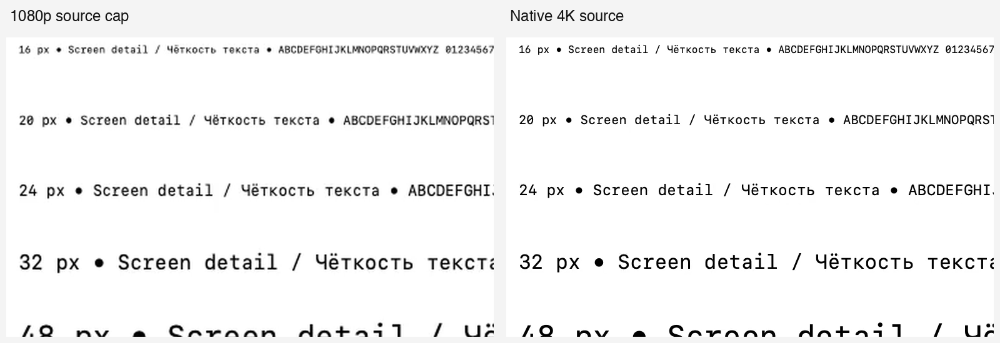

# Screen-sharing text clarity

## Finding and change

Mac capture previously reduced every source to a 1920×1080 rectangle before
encoding. A 3840×2160 Retina source lost three quarters of its pixels. Portrait
sources were also limited by that landscape rectangle. Presenter annotations
introduced another 1920-pixel long-edge limit. Increasing bitrate cannot restore
the text strokes discarded by either resize.

Guest Mac screen capture now preserves native pixels up to 3840 per edge and
8,294,400 pixels, with even output dimensions, aspect preserved and no upscaling.
Both the native and compatibility ScreenCaptureKit adapters use the same policy
for selection and subsequent window resizing. Presenter composition keeps the
same detail when adding annotations or camera overlays.

The policy is explicitly enabled by the guest engine. Other engines and iOS
capture retain their previous budgets. Camera limits, outgoing frame cadence,
hardware-codec selection and congestion control are unchanged. Capture still
uses a three-buffer queue; Presenter retains its bounded compositor pool.

## Live evidence

Generated text chart, Mac → guest SDK → service → independent Chromium receiver,
2026-10-13. No desktop, microphone or camera content was captured. Each source
was held for 15 seconds at five generated updates per second.

| Source pixels | Encoder pixels | Browser-decoded pixels | Encoder | Target bitrate at sample |
| --- | --- | --- | --- | --- |
| 1920×1080 | 1920×1080 | 1920×1080 | H.264 / VideoToolbox | 1.05 Mbps |
| 2560×1440 | 2560×1440 | 2560×1440 | H.264 / VideoToolbox | 2.50 Mbps |
| 3840×2160 | 3840×2160 | 3840×2160 | H.264 / VideoToolbox | 2.50 Mbps |
| 3840×2160 + Presenter annotation | 3840×2160 | 3840×2160 | H.264 / VideoToolbox | 2.50 Mbps |

All phases reported `powerEfficientEncoder=true` and no quality limitation at the
sample time. These are measured target rates, not enforced bandwidth guarantees.
The public screen-share SDK has no bitrate/resolution setter; no signal or sender
bitrate override was introduced.

The reverse test used the web client's ordinary screen-share publication with a
generated 4K canvas. The unmodified Mac and iOS 27 Simulator subscription paths decoded 3840×2160 VP9
frames. It did not impose a 1080p receiving limit. The bundled SDK used its libvpx
decoder for that stream; this change does not claim hardware VP9 decoding.

The comparison uses full-resolution browser-decoded PNGs. The 1080p image is
scaled to the same content size with Lanczos; the 4K crop is at native pixels.
Small text is visibly more legible with native input.

## Validation

- Final Mac run: 80 passed, 5 expected opt-in/platform skips, 0 failures.
- Final iOS 27 Simulator run: 80 passed, 5 expected skips, 0 failures.
- Coverage includes resize coalescing and lifecycle retirement, explicit detail
  opt-in, pixel/edge budgets, large plain/annotated Presenter frames, unchanged
  native transport resize tests, frame conversion, and real guest service tests.
- Mac live sender: independent browser confirmed 1080p, 1440p, 4K and annotated
  4K output. Reverse live tests confirmed 4K web-client reception on Mac and
  Simulator. Raw PNGs were visually inspected at equal content scale.
- This turn did not repeat manual system-picker selection, physical iPhone
  capture, physical-device battery testing or native-engine server qualification.
- Not published to TestFlight in this task.

## Boundaries

- An exploratory 4K change to the separate native transports did not qualify:
  some local H.264 runs produced only one frame before a source resize. That
  production change was discarded. Telemost/TrueConf keep their previous capture
  and sender limits; increasing them needs a separate codec-level investigation.
- More source pixels require larger buffers and more encoding/decoding work.
  This is a clarity improvement, not an energy optimization. No iPhone battery
  measurement was performed.
- A 4K desktop fitted into a small phone view still needs zoom for tiny text.
  Network constraints, server policy and sender choices can reduce received
  quality; local rendering cannot reconstruct detail absent from the stream.
- The chart test validates static text and real transport resolution. It is not
  a saturation, fast-motion, multi-party or cross-server bandwidth benchmark.

Reproduction: `Experiments/ScreenSharing/README.md`. Raw local evidence is under
`.build/screen-quality/`; do not infer production publication from these tests.
